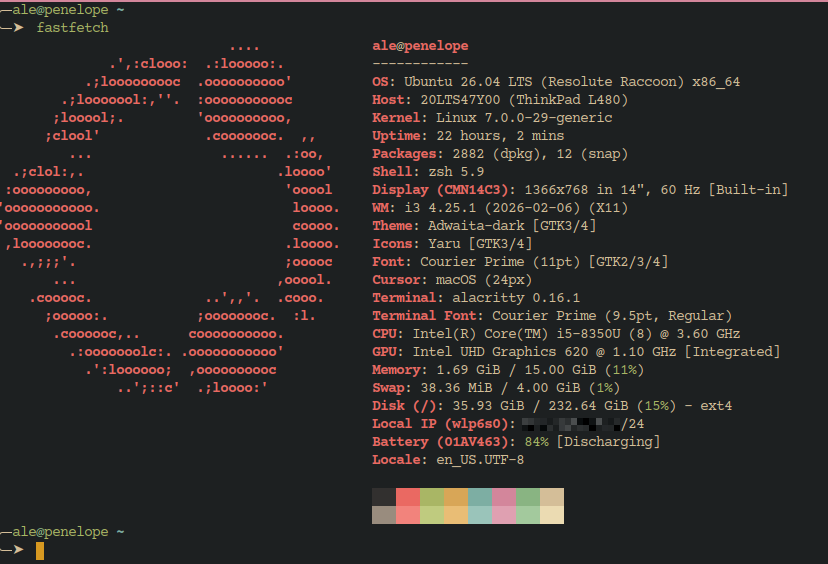

# .zsh

My personal **Zsh** configuration — built on top of [Oh My Zsh](https://ohmyz.sh/).
It bundles a tidy `zshrc` and a big set of aliases & helper functions.



## 🔗 On its own, or as part of best-linux-environment

Both work, and this repo is written not to care which one ran it.

**On its own** — clone it, run [`install.sh`](./install.sh), done. That script
owns every zsh-specific step (Oh My Zsh, the plugins, `~/.zshrc`, the login
shell); nothing outside this repo is needed.

**As part of a whole machine** —
[**best-linux-environment**](https://github.com/Spuppateddu/best-linux-environment)
sets up an entire Ubuntu box, and this is one of the config repos it manages.
Its `./setup.sh` clones this one into `~/linux-configuration/zsh`, leaves
`~/.zsh` behind as a symlink to it, and then calls this repo's own `install.sh`
— the same script, doing the same work. It also keeps it pulled and re-applied
at every boot, and covers two of the optional tools in the table below on its
own account: `yazi` and `lazygit` are listed there as required, named after the
aliases here that call them.

## ✨ Features

- Curated Oh My Zsh setup with the `gnzh` theme.
- Autosuggestions, syntax highlighting and history substring search.
- Handy aliases for Git, Laravel/PHP, Composer, Node and more.
- Machine-local overrides kept **out of version control** (`zsh-alias.local`).

## 📦 Requirements

| Tool | Why |
| --- | --- |
| [Zsh](https://www.zsh.org/) | The shell itself |
| [Oh My Zsh](https://ohmyz.sh/#install) | Framework / plugin loader |
| [tmux](https://github.com/tmux/tmux) | The `ta` / `tn` aliases (optional) |
| [Homebrew](https://brew.sh/) | Referenced for some paths (optional) |
| [yazi](https://github.com/sxyazi/yazi) | The `r` file-manager function (optional) |
| [Qalculate](https://qalculate.github.io/) | The `calc` alias — provides `qalc` (optional) |
| [lazygit](https://github.com/jesseduffield/lazygit) | The `lz` alias (optional) |

`install.sh` installs Zsh, Oh My Zsh and these plugins for you — you only need
this list if you'd rather wire things up by hand:

- [git](https://github.com/ohmyzsh/ohmyzsh/tree/master/plugins/git) *(built-in)*
- [zsh-autosuggestions](https://github.com/zsh-users/zsh-autosuggestions)
- [zsh-syntax-highlighting](https://github.com/zsh-users/zsh-syntax-highlighting)
- [zsh-history-substring-search](https://github.com/zsh-users/zsh-history-substring-search)

## 🚀 Installation

1. **Clone the repo and run the installer:**

   ```sh
   git clone https://github.com/Spuppateddu/configuration-zsh.git ~/.zsh
   ~/.zsh/install.sh
   ```

   `~/.zsh` is the conventional spot, but any path works — `install.sh` wires
   `~/.zshrc` to wherever you cloned it, and `zshrc` resolves its own directory
   at runtime.

   The installer is idempotent, so re-run it any time to update. It installs
   Zsh/git/curl (apt or Homebrew), Oh My Zsh and the three external plugins,
   **appends** `source <repo>/zshrc` to `~/.zshrc` (backing the file up first),
   and sets Zsh as your login shell. If you set `ZDOTDIR`, it wires
   `$ZDOTDIR/.zshrc` instead — the file Zsh actually reads.

   Run it as yourself, **not** with `sudo` — it configures `$HOME`, and under
   `sudo` that is root's. It escalates on its own for the package installs, and
   refuses to run rather than quietly setting root's shell up instead of yours.

   Use `./install.sh --dry-run` to see every
   step without touching anything — `DRY_RUN` from the environment works too and
   accepts `true`/`1`/`yes`/`on` (anything unrecognised is rejected rather than
   quietly treated as a real run).

   The Oh My Zsh *installer* is fetched at a **pinned commit** rather than
   `master`, since it runs as you — bump `OMZ_REF` in `install.sh` when you've
   looked at what changed upstream, or override it per-run with
   `OMZ_REF=master ./install.sh`.

   Be aware that `OMZ_REF` pins **only that installer script**. The installer
   then checks out `master` of Oh My Zsh itself, and the three plugins are
   cloned unpinned and `git pull`ed on every re-run — so re-running the
   installer picks up whatever upstream has published since. That is all
   third-party code sourced into every interactive shell. This is the usual
   dotfiles trade-off (updates for free, upstream trusted); pin `BRANCH` and
   the plugin checkouts to specific commits if you'd rather not take it.

   If you had **no `~/.zshrc`**, Oh My Zsh writes its own template there while it
   installs. The installer recognises that template and replaces it outright
   (keeping a backup) — this repo's `zshrc` loads Oh My Zsh itself.

   If a `~/.zshrc` **you wrote** already sources Oh My Zsh, the installer stops
   before touching it and tells you so: two loads re-run `compinit` and
   double-wrap the syntax-highlighting widgets. Delete the old Oh My Zsh block
   (along with its `ZSH_THEME` and `plugins=` lines) from `~/.zshrc`, then re-run
   the installer.

2. **Set up your machine-local aliases** (SSH hosts, secrets, etc.).
   Create `zsh-alias.local` next to `zsh-alias` — it's gitignored and sourced
   automatically, so your private hostnames/IPs never get committed:

   ```sh
   cat > ~/.zsh/zsh-alias.local <<'EOF'
   # Machine-local aliases — not tracked by git
   alias myserver="ssh user@host-or-ip"
   alias prod="ssh ubuntu@your.prod.ip"
   EOF
   ```

3. **Reload the shell:**

   ```sh
   exec zsh   # or just open a new terminal
   ```

## 🔧 Usage

A few of the aliases you get (see [`zsh-alias`](./zsh-alias) for the full list):

| Alias | Does |
| --- | --- |
| `zshconfig` | `cd` into this repo and `git pull` |
| `zshreload` | Re-exec zsh to pick up config changes |
| `gs` / `gp` | `git status` / `git pull` |
| `lz` | Open `lazygit` |
| `pa <cmd>` | `php artisan <cmd>` |
| `lpm [:sub] [args]` | `php artisan migrate` (`lpm :fresh --seed`) |
| `r` | Open `yazi`, and `cd` to wherever you left it |
| `chrome-debug` | Headless Chrome with remote debugging on `:9222` (`CHROME_DEBUG_PORT` to change) |

## 📁 Layout

```
.zsh/
├── install.sh    # installs deps + wires ~/.zshrc (idempotent)
├── pictures/     # screenshots used by this README
├── zshrc         # main entry point (sourced from ~/.zshrc)
└── zsh-alias     # aliases & functions (sources zsh-alias.local)
# zsh-alias.local — your private, untracked aliases (gitignored)
```

## 📄 License

Personal dotfiles — feel free to copy anything useful.
